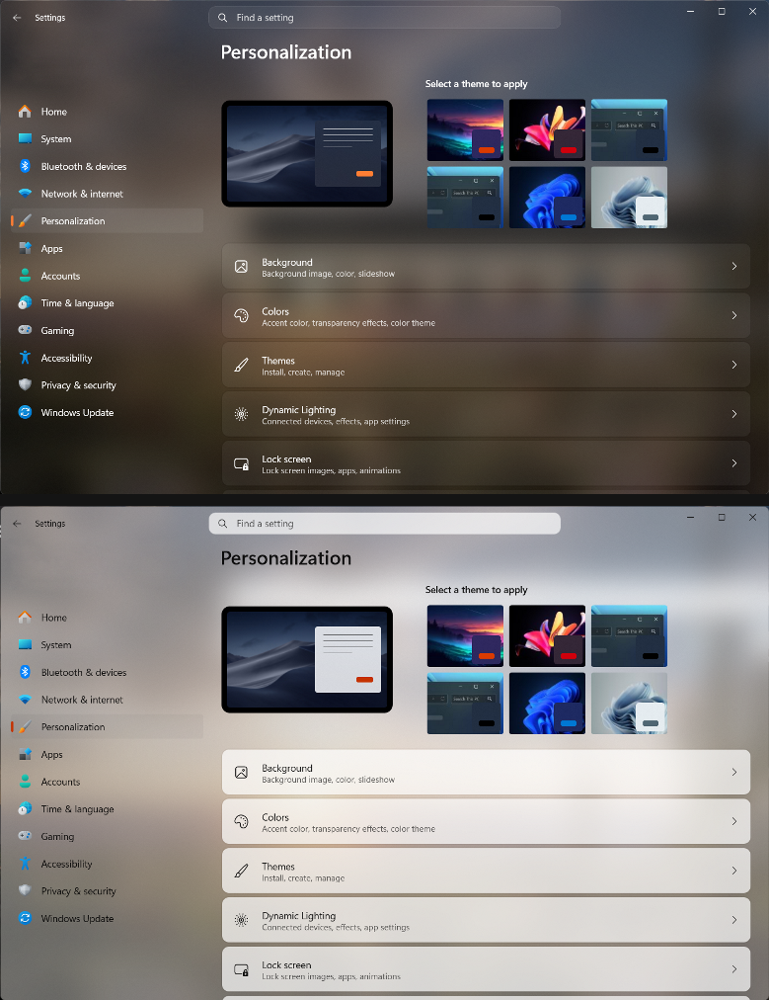

# Translucent Seamless theme for Windows 11 Settings Styler

A borderless, seamless frosted acrylic theme for the Windows 11 Settings app featuring unified glass styling, hidden card outlines, and no dividing sidebar seams.

**Author**: [ArvindSaini978](https://github.com/ArvindSaini978)  

### Preview


## Key Highlights
- **Full Expanded Sidebar**: Keeps navigation labels fully visible while seamlessly blending the sidebar into the content canvas.
- **Seamless Seam Removal**: Eliminates dividing borders and vertical seams between the navigation pane and the main window.
- **Unified Frosted Acrylic**: Coordinates backdrop tinting and blur luminosity across the titlebar, sidebar, and content area.
- **Border & Card Outline Removal**: Strips out card outlines and elevation strokes for a clean floating look.
- **Enhanced Rounding**: Applies smooth corner radiuses across cards, search controls, and list items.

## Theme selection

The theme is integrated into the mod and can be selected directly from the mod's
settings:

* Open the Windows 11 Settings Styler mod in Windhawk.
* Go to the "Settings" tab.
* Select the theme and save the settings.

## Manual installation

The theme styles can also be imported manually. To do that, follow these steps:

* Open the Windows 11 Settings Styler mod in Windhawk.
* Go to the "Settings" tab and select "Textual mode".
* Copy the content below to the text box and click "Save settings".

<details>
<summary>Content to import (click to expand)</summary>

```yaml
styleConstants:
  - OutRadius=8
  - InRadius=10
  - BgBorder=<SolidColorBrush Color="#00000000"/>
  - MainAcrylic=<AcrylicBrush BackgroundSource="HostBackdrop" FallbackColor="{ThemeResource AcrylicFallback}" TintColor="{ThemeResource AcrylicTint}" TintLuminosityOpacity="0.4" TintOpacity="0.35"/>
  - InAppAcrylic=<AcrylicBrush BackgroundSource="Backdrop" FallbackColor="{ThemeResource AcrylicFallback}" TintColor="{ThemeResource AcrylicTint}" TintLuminosityOpacity="0.4" TintOpacity="0.35"/>

themeResourceVariables:
  - AcrylicTint@Dark=#101010
  - AcrylicTint@Light=#F3F3F3
  - AcrylicFallback@Dark=#202020
  - AcrylicFallback@Light=#F3F3F3
  - SearchTint@Dark=#18FFFFFF
  - SearchTint@Light=#66FFFFFF
  - SearchBorder@Dark=#22FFFFFF
  - SearchBorder@Light=#33FFFFFF
  - TextControlBackground@Light:=<SolidColorBrush Color="#05FFFFFF"/>
  - TextControlBackgroundPointerOver@Light:=<SolidColorBrush Color="#15FFFFFF"/>
  - TextControlBackgroundFocused@Light:=<SolidColorBrush Color="#25FFFFFF"/>
  - TextControlBackground@Dark:=<SolidColorBrush Color="#08FFFFFF"/>
  - TextControlBackgroundPointerOver@Dark:=<SolidColorBrush Color="#12FFFFFF"/>
  - TextControlBackgroundFocused@Dark:=<SolidColorBrush Color="#1AFFFFFF"/>
  - ComboBoxDropDownBackground@Light:=<SolidColorBrush Color="#00000000"/>
  - ComboBoxDropDownBackground@Dark:=<SolidColorBrush Color="#00000000"/>
  - MenuFlyoutPresenterBackground@Light:=<SolidColorBrush Color="#00000000"/>
  - MenuFlyoutPresenterBackground@Dark:=<SolidColorBrush Color="#00000000"/>
  - Overlay@Light=#55FFFFFF
  - Overlay@Dark=#09FFFFFF
  - Border@Light=#00000000
  - Border@Dark=#00000000
  - Accent@Dark={ThemeResource SystemAccentColorLight2}
  - Accent@Light={ThemeResource SystemAccentColorDark1}
  - WindowCaptionBackground@Dark=#00000000
  - WindowCaptionBackground@Light=#00000000
  - WindowCaptionBackgroundDisabled@Dark=#00000000
  - WindowCaptionBackgroundDisabled@Light=#00000000
  - SolidBackgroundFillColorBase@Dark=#00000000
  - SolidBackgroundFillColorBase@Light=#00000000
  - SolidBackgroundFillColorSecondary@Dark=#00000000
  - SolidBackgroundFillColorSecondary@Light=#00000000
  - LayerFillColorDefault@Dark=#00000000
  - LayerFillColorDefault@Light=#00000000
  - ApplicationPageBackgroundThemeBrush@Dark=#00000000
  - ApplicationPageBackgroundThemeBrush@Light=#00000000
  - CardStrokeColorDefault@Dark=#00000000
  - CardStrokeColorDefault@Light=#00000000
  - ControlStrokeColorDefault@Dark=#00000000
  - ControlStrokeColorDefault@Light=#00000000
  - SurfaceStrokeColorDefault@Dark=#00000000
  - SurfaceStrokeColorDefault@Light=#00000000
  - NavigationViewItemSeparatorForeground@Dark=#00000000
  - NavigationViewItemSeparatorForeground@Light=#00000000
  - SystemControlForegroundBaseLowBrush@Dark=#00000000
  - SystemControlForegroundBaseLowBrush@Light=#00000000
  - SplitViewPaneBorderBrush@Dark=#00000000
  - SplitViewPaneBorderBrush@Light=#00000000
  - NavigationViewBorderBrush@Dark=#00000000
  - NavigationViewBorderBrush@Light=#00000000

controlStyles:
  - target: SystemSettings.View.SettingsExpander > Grid > SystemSettings.View.ExpanderToggleButton#ContainerButton > ContentPresenter#ContentPresenter
    styles:
      - CornerRadius:=12,12,12,12

  - target: SystemSettings.View.SpacingStackPanel > ContentPresenter > SystemSettings.View.EntityItem > Grid
    styles:
      - CornerRadius:=12

  - target: SystemSettings.View.EntityItem#BluetoothRadioToggleEntityItem > Grid
    styles:
      - CornerRadius:=12

  - target: SystemSettings.View.TwoSegmentsHeroUserControl#DefaultOneSegmentHeroUserControl > Grid#LayoutRoot > Grid#LeftLayout > ContentPresenter > ItemsControl > ItemsPresenter > StackPanel > ContentPresenter > StackPanel > Button > ContentPresenter#ContentPresenter
    styles:
      - CornerRadius:=12
      - Width=250

  - target: SystemSettings.View.SettingsExpander > Grid > ContentPresenter#RevealedContent
    styles:
      - CornerRadius:=12

  - target: Windows.UI.Xaml.Controls.Primitives.ListViewItemPresenter > SystemSettings.View.EntityItem > Grid
    styles:
      - CornerRadius:=$InRadius

  - target: SystemSettings.View.SettingsListViewItem > Windows.UI.Xaml.Controls.Primitives.ListViewItemPresenter > Border
    styles:
      - CornerRadius:=$InRadius

  - target: SystemSettings.View.ButtonEntityItem > Button#ContainerButton > ContentPresenter#ContentPresenter
    styles:
      - CornerRadius:=$InRadius

  - target: Grid#PaneRoot
    styles:
      - Background:=$MainAcrylic
      - BorderThickness=0
      - BorderBrush:=<SolidColorBrush Color="#00000000"/>

  - target: SplitView#RootSplitView
    styles:
      - PaneBorderThickness=0
      - BorderThickness=0
      - PaneBorderBrush:=<SolidColorBrush Color="#00000000"/>
      - BorderBrush:=<SolidColorBrush Color="#00000000"/>

  - target: SplitView#RootSplitView > Grid > Rectangle
    styles:
      - Visibility=Collapsed
      - Width=0

  - target: SplitView#RootSplitView > Grid > Border#PaneBorder
    styles:
      - BorderThickness=0
      - Visibility=Collapsed

  - target: SplitView#RootSplitView > Grid > Grid#ContentRoot
    styles:
      - Margin=-2,0,0,0
      - Background:=<SolidColorBrush Color="#00000000"/>

  - target: SplitView#RootSplitView > Grid > Grid#ContentRoot > Border
    styles:
      - BorderThickness=0
      - BorderBrush:=<SolidColorBrush Color="#00000000"/>

  - target: SplitView#RootSplitView > Grid > Grid#ContentRoot > Border > Grid#ContentGrid
    styles:
      - Background:=$MainAcrylic
      - CornerRadius=0
      - BorderThickness=0
      - BorderBrush:=<SolidColorBrush Color="#00000000"/>

  - target: Grid#ContentRoot
    styles:
      - Background:=<SolidColorBrush Color="#00000000"/>

  - target: Grid#ContentRoot > Border > Grid#ContentGrid > ContentControl#HeaderContent
    styles:
      - Background:=<SolidColorBrush Color="#00000000"/>

  - target: Frame#PermanentNavRootFrame
    styles:
      - Background:=<SolidColorBrush Color="#00000000"/>

  - target: SystemSettings.View.RootPage > Grid#RootPageGrid
    styles:
      - Background:=<SolidColorBrush Color="#00000000"/>

  - target: Microsoft.UI.Xaml.Controls.NavigationView#PermanentNavigationView > Grid#RootGrid
    styles:
      - Background:=<SolidColorBrush Color="#00000000"/>

  - target: Microsoft.UI.Xaml.Controls.NavigationView#PermanentNavigationView > Grid#RootGrid > Grid
    styles:
      - Background:=<SolidColorBrush Color="#00000000"/>

  - target: Grid#TitleBar
    styles:
      - Background:=$MainAcrylic

  - target: Border#TitleBarBackground
    styles:
      - Background:=$MainAcrylic

  - target: StackPanel#SettingsCommandSearchBoxBackground
    styles:
      - CornerRadius=$InRadius
      - MinHeight=32
      - Background:=$BgBorder

  - target: TextBox#CommandSearchTextBox
    styles:
      - CornerRadius=$InRadius
      - VerticalContentAlignment=Center
      - BorderBrush:=<SolidColorBrush Color="{ThemeResource SearchBorder}"/>
      - BorderThickness=1

  - target: TextBox#CommandSearchTextBox > Grid > Border#BorderElement
    styles:
      - CornerRadius=$InRadius
      - BorderBrush:=<SolidColorBrush Color="{ThemeResource SearchBorder}"/>
      - BorderThickness=1

  - target: TextBox#CommandSearchTextBox > Grid > ScrollViewer
    styles:
      - VerticalAlignment=Center

  - target: Windows.UI.Xaml.Shapes.Rectangle#ProgressBarIndicator
    styles:
      - RadiusX=4
      - RadiusY=4
      - Height=6
      - Fill:=<SolidColorBrush Color="{ThemeResource Accent}"/>

  - target: Windows.UI.Xaml.Controls.Border#DeterminateRoot
    styles:
      - CornerRadius=3
      - Height=6

  - target: Windows.UI.Xaml.Controls.ProgressBar
    styles:
      - Height=6

  - target: Windows.UI.Xaml.Controls.StackPanel#TopBreakdownBar > Windows.UI.Xaml.Controls.ProgressBar > Windows.UI.Xaml.Controls.Grid > Windows.UI.Xaml.Controls.Border#DeterminateRoot > Windows.UI.Xaml.Shapes.Rectangle#ProgressBarIndicator
    styles:
      - Height=16

  - target: Windows.UI.Xaml.Controls.StackPanel#TopBreakdownBar > Windows.UI.Xaml.Controls.ProgressBar > Windows.UI.Xaml.Controls.Grid > Windows.UI.Xaml.Controls.Border#DeterminateRoot
    styles:
      - Height=16

  - target: Windows.UI.Xaml.Controls.StackPanel#TopBreakdownBar > Windows.UI.Xaml.Controls.ProgressBar
    styles:
      - Height=16

  - target: SystemSettings.View.SettingsExpander > Grid
    styles:
      - BorderThickness=0
      - BorderBrush:=<SolidColorBrush Color="#00000000"/>

  - target: SystemSettings.View.SettingsExpander
    styles:
      - BorderThickness=0
      - BorderBrush:=<SolidColorBrush Color="#00000000"/>

  - target: Windows.UI.Xaml.Controls.Primitives.ListViewItemPresenter
    styles:
      - BorderThickness=0
      - BorderBrush:=<SolidColorBrush Color="#00000000"/>

  - target: Windows.UI.Xaml.Controls.Primitives.ListViewItemPresenter > Border
    styles:
      - BorderThickness=0
      - BorderBrush:=<SolidColorBrush Color="#00000000"/>

  - target: Border#PopupBorder
    styles:
      - Background:=$InAppAcrylic
      - BorderThickness=0
      - BorderBrush:=$BgBorder

  - target: Border#PopupBorder > ScrollViewer
    styles:
      - Background:=$BgBorder

  - target: Border#PopupBorder > ScrollViewer > Border#Root
    styles:
      - Background:=$BgBorder

  - target: MenuFlyoutPresenter
    styles:
      - Background:=$InAppAcrylic
      - BorderThickness=0
      - BorderBrush:=$BgBorder
  - target: SplitView#RootSplitView > Grid > Grid#PaneRoot
    styles:
      - CornerRadius=0
```
</details>
