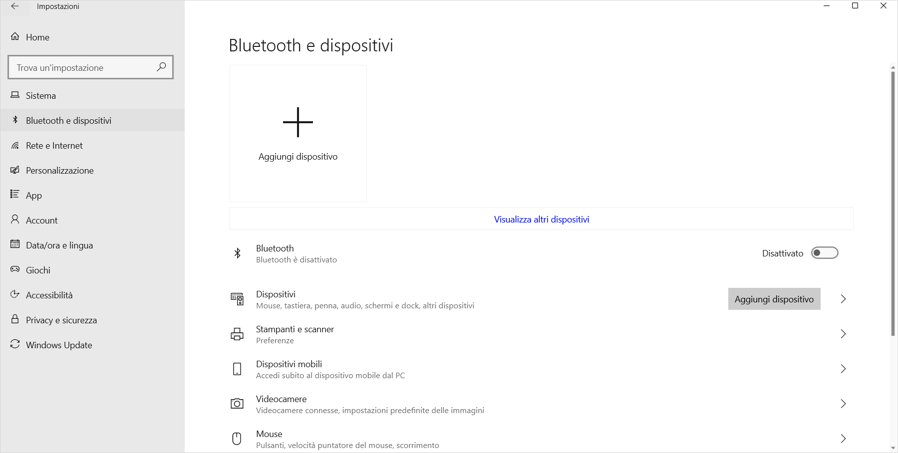
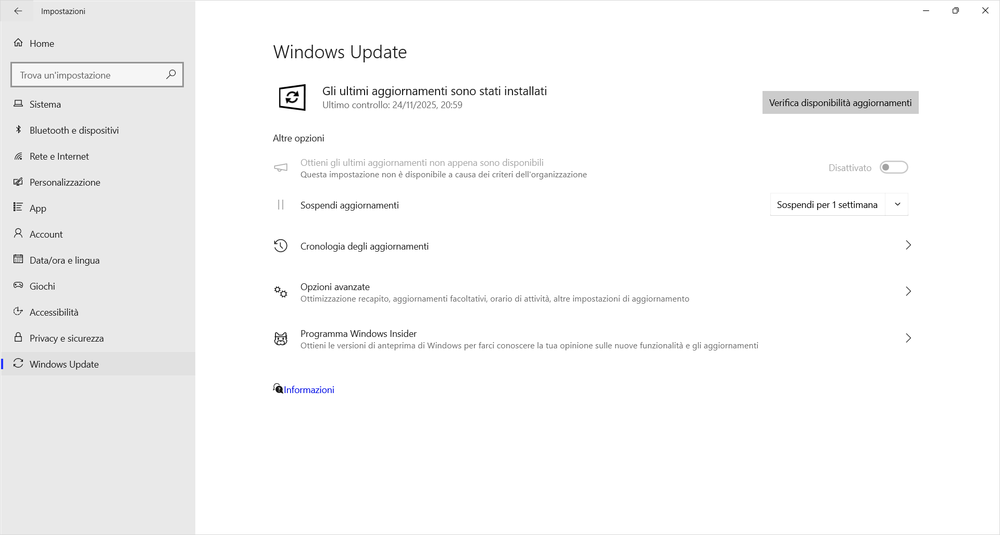

# Windows 10 theme for Windows 11 Settings Styler

A theme that makes the Windows 11 Settings app look like the Windows 10
Settings app: the horizontal category band with tiles at the top, the search
box in the top-left, the "All settings" header, square corners everywhere, the
old accent-green highlight, Windows 10 acrylic on the navigation pane and the
Windows 10 toggle switch / list styles.

**Author**: [@babamohammed2022](https://github.com/babamohammed2022)

**Screenshot**

Windows Update page:

## Requirements

- Windows 11 24H2 (build 26100) - tested.
- [Windhawk](https://windhawk.net/) 1.7.3.
- The [Windows 11 Settings Styler](https://windhawk.net/mods/windows-11-settings-styler)
  mod installed and enabled.
- For best results use the **Windows 10 taskbar / Start** look from the
  matching taskbar and start menu styling guides, otherwise the Settings app
  will look like Windows 10 inside a Windows 11 shell.

## Theme selection

Once this theme is merged into the mod, it can be selected directly from the
mod's settings:

- Open the Windows 11 Settings Styler mod in Windhawk.
- Go to the "Settings" tab.
- Select the theme and save the settings.

## Manual installation

The theme styles can also be imported manually. To do that, follow these steps:

- Open the Windows 11 Settings Styler mod in Windhawk.
- Go to the "Settings" tab and select "Textual mode".
- Copy the content of [`theme.yaml`](theme.yaml) to the text box and click
  "Save settings".

## Notes

- The theme sets `theme: ''` and is fully self-contained (`styleConstants`,
  `controlStyles`, `themeResourceVariables`). It is based on the same selector
  syntax documented in
  [the Windows 11 Settings styling guide](https://github.com/ramensoftware/windows-11-settings-styling-guide).
- A few rules target localized labels (the navigation items whose content is
  `System` / `Sistema` / `Système` and the "All settings" text): if your
  display language is not covered, add your own variant of the
  `SystemSettings.View.SettingsNavigationViewItem[Content=...]` selector.
- Element names in the Settings app change between Windows builds. If a rule
  stops applying after a feature update, use
  [UWPSpy](https://github.com/bbmaster123/FWFU/blob/main/Guides/uwpspy.md) to
  find the new target and update the `target:` line.
